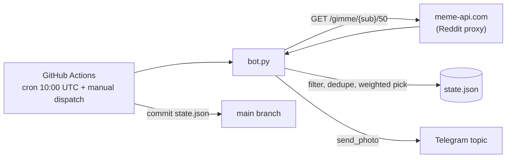

# mobile_meme_bot

A Telegram bot that posts one random IT meme a day to a topic of a university mobile-development group chat. It runs as a one-shot script on a GitHub Actions schedule, so there is no server to host.


## Features

- Pulls the hot posts of `r/ProgrammerHumor` and `r/programmingmemes` (50 per subreddit, fetched in parallel).
- Filters out NSFW posts, spoilers, non-image URLs and posts below 500 upvotes.
- Picks the meme with a **weighted random choice** (probability proportional to upvotes), so popular memes win more often but the feed stays varied.
- Never repeats a meme: seen posts are stored as short MD5 hashes of the image URL in `state.json`. When the pool is exhausted the list resets.
- Keeps the caption within Telegram's 1024-character limit by trimming the title.
- Posts into a specific forum topic via `message_thread_id`.
- Exits with a non-zero code when no meme is available, so the workflow does not commit a stale state and the next run simply retries.

## How it works



Memes come from [meme-api.com](https://github.com/D3vd/Meme_Api) rather than Reddit directly, because Reddit blocks anonymous requests from cloud IPs such as GitHub runners.

## Tech stack

| Area | Tools |
| --- | --- |
| Language | Python 3.10 |
| Telegram | aiogram |
| HTTP | aiohttp |
| Scheduling and state | GitHub Actions (`.github/workflows/meme.yml`), `state.json` committed back to the repo |

## Project structure

```
.
├── bot.py                      # fetch, filter, pick, post
├── state.json                  # hashes of already posted memes
├── requirements.txt
└── .github/workflows/meme.yml  # daily cron + manual dispatch
```

## Getting started

```bash
pip install -r requirements.txt
BOT_TOKEN=<your bot token> python bot.py
```

The target chat and topic ids (`CHAT_ID`, `TOPIC_ID`) and the subreddit list (`SUBS`) are constants at the top of `bot.py`. To run it on GitHub Actions, add `BOT_TOKEN` as a repository secret. The workflow runs daily at 10:00 UTC and can also be started manually.
